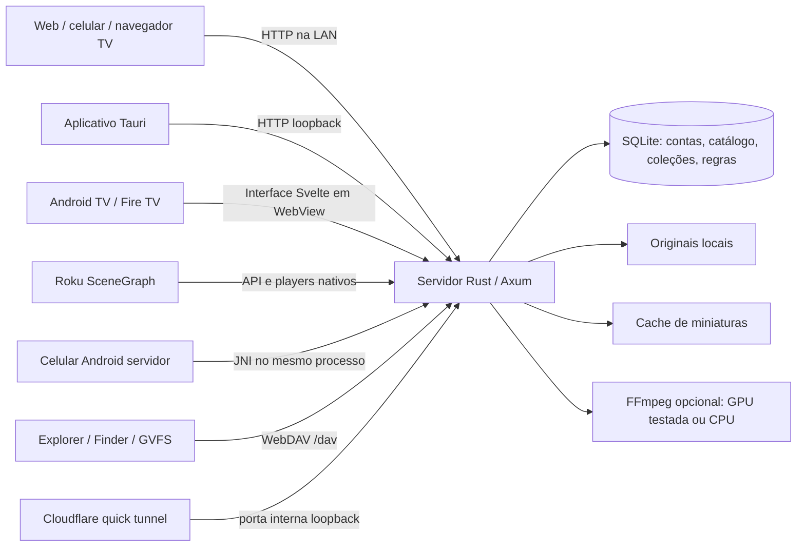

# Arquitetura

## Limites entre módulos

`server` é uma biblioteca Rust com `AppState`, construção do router e inicialização do armazenamento; o binário é apenas o host de rede. `src-tauri` reutiliza essa biblioteca dentro do próprio processo. Não há serviço Node em produção nem dependência do CtrlB. O JavaScript compilado de `src` é incorporado por `rust-embed`, inclusive em builds debug, para que o executável não dependa da pasta `dist` da máquina de compilação.

O Tauri abre a URL de loopback e não oferece comandos nativos ao conteúdo web. O servidor vincula a porta antes de criar a janela, impedindo anexar silenciosamente a um processo estranho. `sonam_server::run` é o ciclo de vida compartilhado (binário, Tauri e Android): serve o router, inicia o verificador da pasta monitorada, anuncia o nome mDNS e restaura o túnel se estiver ligado. No Android, `clients/android/rust` expõe `start/stop/isRunning` por JNI; o `ServerService` (serviço em primeiro plano `specialUse`) controla quando o servidor existe, e a Activity apenas exibe a interface em WebView ligada a `127.0.0.1`. O ponto de entrada mobile do Tauri não é usado para o servidor Android.

## Unidade de rede e pasta monitorada

`/dav` é servido por `dav-server` sobre `DADOS/drive`, com travas em memória (Windows e macOS exigem LOCK). A autenticação é Basic com nome/senha da conta (ou cookie da sessão); credenciais válidas ficam em cache por hash durante 10 minutos para não repetir Argon2 a cada requisição WebDAV. `media.path` referencia arquivos dentro de `drive/Biblioteca`; `media.path IS NULL` continua significando blob em `media/ID`. O scanner compara a árvore com o banco: novos arquivos com assinatura de mídia viram itens; arquivos que somem com o mesmo tamanho e data reaparecendo em outro caminho são tratados como movidos, preservando ID, progresso e coleções. Escritas WebDAV disparam uma nova verificação após 2 s; há verificação periódica a cada 2 min.

## Endereços

Host permitido = localhost, IP literal, `<nome>.local` configurado, host do túnel ativo ou `SONAM_PUBLIC_HOST`. O túnel recebe uma instância separada do router em uma porta loopback aleatória com uma camada que troca o `ConnectInfo` pelo `CF-Connecting-IP`; assim, privilégios de loopback nunca se aplicam a visitantes externos.

`users` representa contas reais, cada uma com credencial e sessão próprias. Não existe um seletor que permita trocar livremente para um perfil mais privilegiado. A tela pareada assume a conta de quem aprovou o PIN. A avaliação de políticas é refeita em cada requisição usando o estado atual do banco; o frontend não é uma fronteira de autorização.

`media` registra metadados leves e um ID interno; o blob reside em `media/ID`. Coleções são uma relação muitos-para-muitos com posição reservada no schema. A UI atual ainda não expõe reordenação manual. Bloqueios são negativos e uma coleção proibida prevalece sobre qualquer associação permitida. O catálogo é compartilhado na casa, com restrições por conta: o dono de upload registrado não equivale a um cofre privado por proprietário.

## Reprodução

O caminho rápido usa `ServeFile`, com Range, sem ler o vídeo completo para a memória. A fonte permanece protegida por autenticação e política de perfil. A rede entrega bytes; o player do cliente escolhe o caminho de decodificação. Para compatibilidade, o servidor inicia um processo FFmpeg por conexão, com um semáforo global para impedir múltiplas conversões pesadas. O corpo da resposta mantém o processo e a permissão; descartar o corpo encerra o filho. Não se usa shell para montar comandos.

O motor de hardware testa uma codificação curta real. Com GPU desativada, não executa esse teste. A preferência de GPU não modifica reprodução direta. O caminho atual não implementa negociação completa de codecs, remux, HLS ou seleção automática de qualidade. É um fallback explícito no player. Falha específica de hardware pode ser contornada pelo botão que força CPU.

Miniaturas são produzidas sob demanda fora do executor assíncrono, com limite de dois decodificadores e cache em disco. Arquivos continuam exigindo autorização mesmo depois de cacheados. Geração limitada ou formato não suportado usa original como fallback. Não se envia conteúdo a um provedor externo para classificação.

## Evolução

Antes de bibliotecas muito grandes: substituir listagens completas por paginação com filtros de autorização no SQL, indexar pesquisa textual, virtualizar a UI e colocar extração de metadados/miniaturas em fila persistente. Isso deve preservar a autorização antes da exposição de resultados e contagens. Para pesquisa visual, adicionar modelos locais opcionais e política explícita de recursos/privacidade.

O cliente Roku é independente porque o sistema utiliza SceneGraph. O cliente Android TV atual é um host leve da UI web; um player Media3 nativo pode ampliar o suporte de codecs/legendas, mantendo o mesmo protocolo. A geração de pacotes é distinta de teste físico e certificação de loja.
